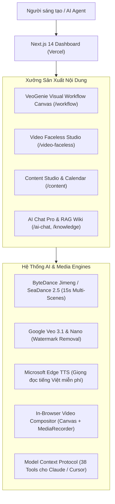

# Video2026 — Nền Tảng Sản Xuất Video & Tự Động Hóa AI Đa Kênh

[](https://vercel.com/new/clone?repository-url=https://github.com/mrbit4578/video2026.notech)

**Video2026** là nền tảng sản xuất video AI và kiếm tiền trực tuyến thế hệ mới, hợp nhất sức mạnh giữa **VeoGenie Tool Agent v0.1.54** (Visual Node Workflow & Dola SeaDance 2.5 / Google Veo) và **OpenRemoteHub Kiemtien2026** (Next.js 14, RAG Knowledge Graph, Faceless Video Studio, Social Publishing).

- **GitHub Repository**: [https://github.com/mrbit4578/video2026.notech](https://github.com/mrbit4578/video2026.notech)
- **Vercel Deployment**: [https://vercel.com/mrbit4578-4403s-projects](https://vercel.com/mrbit4578-4403s-projects)
- **Production API Backend (Render)**: `https://kiemtien2026-api-docker-l97m.onrender.com`

---

## 🚀 Tính Năng Nổi Bật (Kaizen Tinh Hoa)



### 1. VeoGenie Visual Workflow Studio (`/workflow`)
- Trực tiếp kéo thả các khối xử lý: **Prompt Block** $\to$ **Reference Images** $\to$ **Dola SeaDance 2.5 / Google Veo** $\to$ **Node Preview / Export**.
- Hỗ trợ xuất/nhập toàn bộ quy trình dưới dạng JSON.
- Tương thích 100% cả trên nền tảng Web Online (Vercel) lẫn Desktop.

### 2. Video Faceless Studio & In-Browser Compositor (`/video-faceless`)
- Sinh kịch bản phân cảnh tự động (Text, Prompt hình ảnh, Góc quay camera, Thời lượng).
- Tích hợp **Microsoft Edge TTS** miễn phí với giọng đọc tự nhiên tiếng Việt (`vi-VN-HoaiMyNeural`, `vi-VN-NamMinhNeural`).
- Ghép video dọc 9:16 chuẩn TikTok/Reels/Shorts ngay trong trình duyệt mà không cần cài đặt FFmpeg nặng trên máy.

### 3. Dola SeaDance 2.5 Multi-Scenes Pro Protocol
- Giao thức chuẩn tạo video 15s hàng loạt nhiều cảnh theo đặc tả `DOLA_SEEDANCE_25_CONTINUOUS_VIDEO_SKILL`.
- Tự động bổ sung thông số Camera Direction, Aspect Ratio, Resolution suffix cho từng cảnh.

### 4. Hệ Thống Model Context Protocol (MCP) Server
- Cung cấp **38 công cụ chuẩn MCP** tại `packages/veogenie-core/veogenie-mcp-server.mjs`.
- Cho phép AI Agent (Claude Desktop, Cursor, Antigravity) điều khiển trực tiếp workflow, thêm node, chạy kịch bản và xuất video.

### 5. AI Pro RAG & Knowledge Graph
- Hỗ trợ 5 kiến trúc RAG hiện đại: **Hybrid**, **GraphRAG**, **Agentic**, **Corrective**, **Multimodal**.
- Kết nối an toàn các API Key: Gemini, OpenAI, Claude, Grok, DeepSeek, VyceAI, Pollinations.

---

## 📦 Cấu Trúc Monorepo

```text
video2026.notech/
├── apps/
│   ├── web/                     # Next.js 14 Web Dashboard (Deploy Vercel)
│   │   ├── src/app/
│   │   │   ├── workflow/        # VeoGenie Visual Workflow Canvas Studio
│   │   │   ├── video-faceless/  # Faceless Video Production Studio
│   │   │   ├── content/         # Lịch xuất bản & Kiểm duyệt ToS
│   │   │   ├── ai-chat/         # AI Chat Pro đa kiến trúc RAG
│   │   │   └── knowledge/       # Kho tri thức & Vector Ingest
│   │   └── public/
│   │       └── workflow-canvas/ # Giao diện tương tác VeoGenie Canvas
│   ├── api/                     # NestJS REST API Server (Deploy Render/Railway)
│   └── worker/                  # BullMQ Background Worker
├── packages/
│   ├── veogenie-core/           # Decrypted VeoGenie MCP Server & Runtime
│   ├── auth/                    # OAuth PKCE & Session Management
│   ├── connectors/              # Google, Meta, TikTok Connectors
│   ├── crypto/                  # Envelope Encryption (AES-256-GCM)
│   ├── policy/                  # ToS Compliance & Consent Rules
│   └── shared/                  # Type Definitions & Error Codes
├── docs/
│   └── skills/                  # Dola SeaDance 2.5 Skill & Specs
├── vercel.json                  # Cấu hình tối ưu deploy Vercel
└── pnpm-workspace.yaml          # Monorepo Workspace Configuration
```

---

## 🛠️ Hướng Dẫn Cài Đặt & Chạy Local

### Yêu cầu môi trường
- Node.js >= 18 (khuyên dùng Node.js 20 hoặc 22)
- pnpm >= 9 (`npm install -g pnpm`)

### 1. Cài đặt Dependencies
```bash
pnpm install
```

### 2. Khởi chạy Web Dashboard
```bash
pnpm --filter @orh/web dev
```
Truy cập: `http://localhost:3000`

### 3. (Tùy chọn) Chạy Backend API Cục Bộ
```bash
# Cần PostgreSQL có pgvector và Redis
pnpm --filter @orh/api dev
```
Hoặc sử dụng API đã deploy sẵn trên Render: `https://kiemtien2026-api-docker-l97m.onrender.com`.

---

## 🌐 Hướng Dẫn Deploy Lên Vercel

1. **Kết nối GitHub Repository**:
   - Truy cập Vercel Dashboard: [https://vercel.com/mrbit4578-4403s-projects](https://vercel.com/mrbit4578-4403s-projects)
   - Chọn **Add New...** &rarr; **Project** &rarr; Import repo `https://github.com/mrbit4578/video2026.notech`.
2. **Thiết lập Project**:
   - **Framework Preset**: `Next.js`
   - **Root Directory**: `apps/web` (hoặc để trống root nếu dùng script monorepo).
   - **Build Command**: `next build` (hoặc `pnpm --filter @orh/web build`).
3. **Biến môi trường (Environment Variables)**:
   - `NEXT_PUBLIC_API_URL`: `https://kiemtien2026-api-docker-l97m.onrender.com`
4. **Deploy**: Bấm **Deploy**. Vercel sẽ tự động build và tạo URL live trong vòng 1-2 phút!

---

## 📄 Bản Quyền & Giấy Phép

Dự án được phát hành theo giấy phép **AGPLv3** nhằm phục vụ cộng đồng nghiên cứu, sáng tạo nội dung và tự động hóa AI minh bạch.
